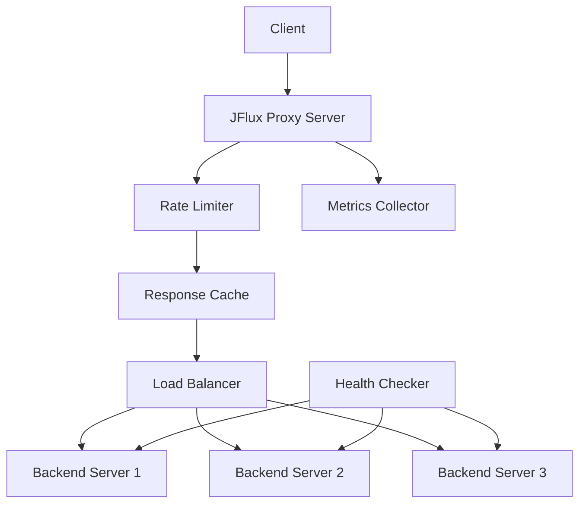

# ⚡ JFlux

<h3 align="center">A Lightweight and Modular Java-Based Reverse Proxy & Backend Traffic Management System</h3>

<p align="center">
  <strong>Smart Traffic Distribution. Reliable Backend Communication.</strong>
</p>

<p align="center">
  <a href="README.md">🇬🇧 English</a> · <a href="README_TR.md">🇹🇷 Türkçe</a>
</p>

<p align="center">
  
  
  
  
  
</p>

---

## 🚀 Overview

**JFlux** is a lightweight **Reverse Proxy** server application developed from scratch using Java. It receives incoming HTTP requests and distributes them across multiple backend servers.

The project brings together essential backend infrastructure concepts in a modular architecture, including load balancing, response caching, rate limiting, health checks, automatic failover, and real-time performance metrics.

JFlux demonstrates how modern backend systems manage incoming traffic, tolerate server failures, and maintain reliable communication between clients and services.

## ✨ Key Features

| Feature | Description |
| :--- | :--- |
| 🔀 **Reverse Proxy** | Receives incoming HTTP requests from clients and forwards them to backend servers. |
| ⚖️ **Load Balancer** | Distributes incoming requests among active servers using the Round-Robin algorithm. |
| ⚡ **Response Cache** | Stores successful `GET` responses in memory for a configurable TTL period. |
| 🛡️ **Rate Limiter** | Limits the number of requests per minute based on client IP addresses (`429`). |
| 💓 **Health Checks** | Periodically checks the availability of backend servers. |
| 🔄 **Automatic Failover** | Redirects requests to another healthy server when a backend becomes unavailable. |
| 🔁 **Retry Mechanism** | Provides a configurable retry mechanism for failed requests. |
| 📊 **Metrics Collector** | Exposes request statistics and backend-specific success rates through `/_jflux/metrics`. |
| 🧵 **Virtual Threads** | Efficiently handles concurrent client connections using Java Virtual Threads. |

## 🏗️ System Architecture

JFlux follows a modular architecture in which each component is responsible for a specific stage of the request-processing pipeline.



### Core Components

- **ProxyServer:** Manages the main socket server and incoming connections.
- **ClientHandler:** Parses client requests and handles caching and backend communication.
- **LoadBalancer:** Selects a healthy backend server and coordinates health checks.
- **ResponseCache:** Manages temporary responses using a TTL-based caching mechanism.
- **RateLimiter:** Controls request frequency on a per-client basis.
- **MetricsCollector:** Collects application performance metrics.
- **ProxyConfig:** Loads runtime configuration from `config.properties`.

## 🛠️ Tech Stack

<p align="center">
  
  
  
</p>

| Technology | Purpose |
| :--- | :--- |
| **Java 25** | Core application development |
| **Maven** | Project and build management |
| **Java Sockets** | Listening for and managing client connections |
| **Java HttpClient** | HTTP communication with backend servers |
| **Virtual Threads** | Highly concurrent I/O processing |
| **ConcurrentHashMap** | Thread-safe memory and cache management |
| **AtomicInteger / AtomicLong** | Lock-free atomic counter operations |
| **ScheduledExecutorService** | Periodic health check tasks |

## 📂 Project Structure

```text
JFlux/
│
├── src/
│   └── main/
│       ├── java/
│       │   └── com/jflux/
│       │       ├── balancer/
│       │       │   └── LoadBalancer.java
│       │       ├── cache/
│       │       │   └── ResponseCache.java
│       │       ├── config/
│       │       │   └── ProxyConfig.java
│       │        ├── metrics/
│       │        │   └── MetricsCollector.java
│       │        ├── model/
│       │        │   ├── BackendServer.java
│       │        │   └── HttpResponseData.java
│       │        ├── ratelimit/
│       │        │   └── RateLimiter.java
│       │        ├── server/
│       │        │   ├── ClientHandler.java
│       │        │   └── ProxyServer.java
│       │        ├── testutil/
│       │        │   └── MockBackendRunner.java
│       │        └── Main.java
│       │
│       └── resources/
│           └── config.properties
│
├── pom.xml
├── README.md
└── README_TR.md
```

## ⚙️ Getting Started

### Prerequisites

- Java JDK 25
- Apache Maven
- IntelliJ IDEA (recommended)

### 1. Clone the Repository

```bash
git clone https://github.com/mirayyozcann/JFlux.git
cd JFlux
```

### 2. Build the Project

```bash
mvn clean compile
```

### 3. Start the Mock Backend Servers

Run the following class from IntelliJ IDEA. It starts mock backend servers on ports `9001`, `9002`, and `9003`.

```text
com.jflux.testutil.MockBackendRunner
```

### 4. Start JFlux

Run the main class:

```text
com.jflux.Main
```

### 5. Send a Request

```bash
curl http://localhost:8080/
```

## 📊 Metrics Endpoint

```text
http://localhost:8080/_jflux/metrics
```

## 🎯 Project Goals

- Gain an in-depth understanding of reverse proxy architecture.
- Practice load-balancing strategies.
- Explore concurrent programming with Java Virtual Threads.
- Manage backend availability and fault-tolerance scenarios.
- Implement caching and rate-limiting mechanisms.
- Collect and monitor application metrics.

## 🔮 Future Improvements

- Expand automated unit and integration test coverage.
- Implement advanced HTTP header forwarding rules.
- Improve cache eviction policies.
- Enhance observability and logging.
- Introduce additional load-balancing algorithms (e.g., **Least Connections**).

## 📌 Project Status

JFlux is a backend infrastructure project designed to demonstrate reverse proxy and traffic management concepts. It is open to further development and improvements.

---

<p align="center">
  <strong>⚡ JFlux — Lightweight Proxy. Smarter Traffic Management.</strong>
</p>
