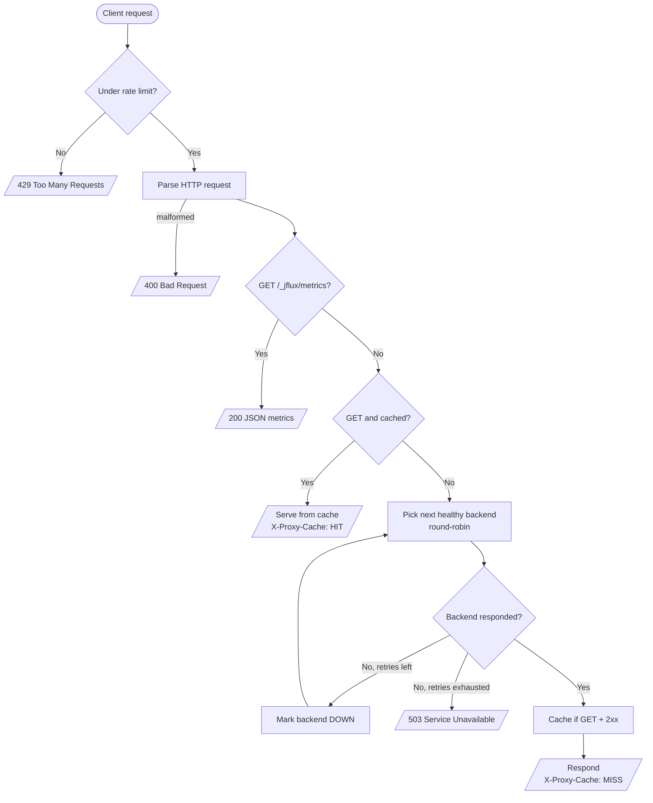

<div align="center">

# ⚡ JFlux

**A lightweight, zero-dependency HTTP reverse proxy and load balancer written in pure Java.**

Round-robin load balancing · Automatic failover · Response caching · Rate limiting · Live metrics


**🇬🇧 English** · [🇹🇷 Türkçe](README.tr.md)

</div>

---

## Table of Contents

- [Overview](#overview)
- [Features](#features)
- [Architecture](#architecture)
- [Getting Started](#getting-started)
- [Configuration](#configuration)
- [Usage & Demo](#usage--demo)
- [Metrics Endpoint](#metrics-endpoint)
- [How It Works](#how-it-works)
- [Project Structure](#project-structure)
- [Known Limitations](#known-limitations)
- [Roadmap](#roadmap)
- [Author](#author)

---

## Overview

JFlux sits in front of your backend services and distributes incoming HTTP traffic across them. It was built from scratch on top of the Java standard library only — raw `ServerSocket` for the network layer, `java.net.http.HttpClient` for upstream calls, and **virtual threads** (Project Loom) so that every client connection gets its own lightweight thread without the cost of a thread pool.

It is small enough to read in an afternoon (~800 lines), yet covers the core building blocks of a production reverse proxy: load balancing, health checking, failover, caching, rate limiting, and observability.

```
                         ┌──────────────────────────────────────────┐
                         │                  JFlux                   │
                         │                                          │
   Clients ───────────►  │  Rate Limit → Cache → Load Balancer ─────┼──►  Backend :9001
   (curl, browser,       │      │          │          │   ▲        │──►  Backend :9002
    services…)           │      ▼          ▼          ▼   │        │──►  Backend :9003
                         │    429        HIT/MISS   Retry/Failover │
                         │                          Health Checks   │
                         └──────────────────────────────────────────┘
```

## Features

| | Feature | Description |
|---|---|---|
| ⚖️ | **Round-robin load balancing** | Requests are spread evenly across all *healthy* backends. |
| 🩺 | **Active health checks** | A background task probes every backend over TCP at a configurable interval and automatically marks servers `UP` / `DOWN`. |
| 🔁 | **Passive failover & retries** | If a backend fails mid-request, it is immediately marked `DOWN` and the request is retried on a different backend — the client never notices. |
| 🗄️ | **In-memory response cache** | Successful `GET` responses (`2xx`) are cached with a configurable TTL. Cached responses are tagged with `X-Proxy-Cache: HIT`. |
| 🚦 | **Per-client rate limiting** | Fixed-window limiter per client IP. Excess requests receive `429 Too Many Requests`. |
| 📊 | **Built-in metrics** | A JSON endpoint exposes request counts, cache hit/miss, rate-limited and failed requests, and per-backend traffic. |
| 🧵 | **Virtual threads** | One virtual thread per connection (`Executors.newVirtualThreadPerTaskExecutor()`) for simple, blocking-style code that still scales. |
| ⚙️ | **Flexible configuration** | Properties file (external or bundled) with safe built-in defaults. Invalid values never crash the proxy — they fall back to defaults. |
| 📦 | **Zero dependencies** | Nothing to download beyond the JDK itself. |

## Architecture

### Request lifecycle



### Components

| Component | Responsibility |
|---|---|
| `ProxyServer` | Accepts TCP connections and hands each one to a virtual thread. Owns the lifecycle of all other components. |
| `ClientHandler` | Parses the request, applies rate limit → metrics route → cache → forwarding with retry, and writes the response. |
| `LoadBalancer` | Maintains the backend list, performs round-robin selection over healthy servers, and runs the scheduled TCP health checks. |
| `ResponseCache` | Thread-safe TTL cache backed by a `ConcurrentHashMap`; entries expire lazily on read. |
| `RateLimiter` | Thread-safe fixed-window counter per client key (IP address). |
| `MetricsCollector` | Lock-free counters (`AtomicLong`) rendered as JSON on demand. |
| `ProxyConfig` | Immutable `record` loaded from `config.properties` with defaulting and validation. |
| `MockBackendRunner` | Spins up three tiny demo backends on ports `9001–9003` for local testing. |

## Getting Started

### Prerequisites

- **JDK 25** (the version targeted in `pom.xml`)
- **Apache Maven 3.9+** *(optional — you can also compile with plain `javac`)*

> 💡 The code only uses features available since Java 21 (records, switch expressions, virtual threads). If you need to run on an older JDK, lower `maven.compiler.source` / `target` in `pom.xml` accordingly.

### 1. Clone & build

```bash
git clone https://github.com/mirayyozcann/JFlux.git
cd JFlux
mvn clean compile
```

<details>
<summary>Build without Maven</summary>

```bash
mkdir -p out
javac -d out $(find src/main/java -name "*.java")
# run with: java -cp out:src/main/resources com.jflux.Main
```

</details>

### 2. Start the demo backends

In a first terminal:

```bash
java -cp target/classes com.jflux.testutil.MockBackendRunner
```

```
Mock backend started on http://localhost:9001
Mock backend started on http://localhost:9002
Mock backend started on http://localhost:9003
```

### 3. Start JFlux

In a second terminal:

```bash
java -cp target/classes com.jflux.Main
```

```
JFlux Reverse Proxy listening on http://localhost:8080
Backends: [http://localhost:9001, http://localhost:9002, http://localhost:9003]
Metrics endpoint: http://localhost:8080/_jflux/metrics
```

Stop it at any time with `Ctrl+C` — a shutdown hook stops the health checker and the server cleanly.

## Configuration

JFlux reads `config.properties`. Lookup order:

1. `./config.properties` in the **current working directory** (external override — no rebuild needed)
2. `config.properties` bundled on the **classpath** (`src/main/resources`)
3. **Built-in defaults**

Missing or unparsable values silently fall back to their defaults.

| Property | Default | Description |
|---|---|---|
| `proxy.port` | `8080` | Port the proxy listens on. |
| `backend.urls` | `http://localhost:9001,http://localhost:9002,http://localhost:9003` | Comma-separated list of backend base URLs. |
| `cache.ttl.millis` | `10000` | Lifetime of a cached `GET` response in milliseconds. Set to `0` to disable caching. |
| `ratelimit.max.per.minute` | `30` | Maximum requests per client IP per 60-second window. Set to `0` to disable rate limiting. |
| `healthcheck.interval.millis` | `5000` | Interval between TCP health checks (connect timeout: 1 s). |
| `proxy.max.retries` | `3` | Maximum number of backend attempts per request (minimum effective value: `1`). |

**Example** — a production-like profile placed next to the JAR/classes:

```properties
proxy.port=80
backend.urls=http://10.0.0.11:8000,http://10.0.0.12:8000
cache.ttl.millis=30000
ratelimit.max.per.minute=300
healthcheck.interval.millis=3000
proxy.max.retries=2
```

## Usage & Demo

### Load balancing

Each request lands on the next backend in the rotation:

```bash
curl -i localhost:8080/hello1
curl -i localhost:8080/hello2
curl -i localhost:8080/hello3
curl -i localhost:8080/hello4
```

```
Hello from backend on port 9001 | path=/hello1
Hello from backend on port 9002 | path=/hello2
Hello from backend on port 9003 | path=/hello3
Hello from backend on port 9001 | path=/hello4
```

### Caching

Repeat the same `GET` within the TTL window and inspect the `X-Proxy-Cache` header:

```bash
curl -si localhost:8080/hello1 | grep X-Proxy-Cache   # X-Proxy-Cache: MISS
curl -si localhost:8080/hello1 | grep X-Proxy-Cache   # X-Proxy-Cache: HIT
```

Proxy log:

```
[FORWARD] GET /hello1 -> http://localhost:9001 (200, attempts=1)
[CACHE HIT] GET /hello1
```

### Failover

1. Stop one of the mock backends (e.g. kill the process on port `9002`, or stop the runner and start only two ports).
2. Keep sending requests — none of them fail. JFlux detects the dead backend, logs it, and routes around it:

```
[FAILOVER] Attempt 1 failed on http://localhost:9002 (...), marking DOWN and retrying...
```

3. When the backend comes back, the next health check marks it `UP` again:

```
[HEALTH] http://localhost:9002 -> UP
```

If **every** backend is down, clients receive `503 Service Unavailable`.

### Rate limiting

With the default limit of 30 requests/minute per IP:

```bash
for i in $(seq 1 35); do curl -s -o /dev/null -w "%{http_code} " localhost:8080/page$i; done
# 200 200 200 ... 200 429 429 429 429 429
```

Rate-limited requests are counted in the metrics endpoint and never reach a backend.

## Metrics Endpoint

```bash
curl localhost:8080/_jflux/metrics
```

```json
{
  "totalRequests": 42,
  "cacheHits": 9,
  "cacheMisses": 28,
  "rateLimited429": 5,
  "failed503": 0,
  "backendSuccess": {"http://localhost:9001":10, "http://localhost:9002":9, "http://localhost:9003":9}
}
```

| Field | Meaning |
|---|---|
| `totalRequests` | Every connection accepted by the proxy (including rate-limited ones). |
| `cacheHits` | Requests answered directly from the cache. |
| `cacheMisses` | Requests that had to go to a backend (this includes non-`GET` methods, which are never cached). |
| `rateLimited429` | Requests rejected by the rate limiter. |
| `failed503` | Requests for which every backend attempt failed. |
| `backendSuccess` | Successful responses served per backend — a quick way to verify balance. |

## How It Works

**Load balancing.** `LoadBalancer.nextServer()` filters the backend list down to healthy servers and picks one using an atomic counter and `Math.floorMod`, giving thread-safe round-robin without locks.

**Health checks.** A single-threaded `ScheduledExecutorService` opens a TCP connection to every backend every `healthcheck.interval.millis`. State changes (`UP` ⇄ `DOWN`) are logged.

**Failover.** If forwarding throws an `IOException` (connection refused, timeout, …), the backend is marked `DOWN` immediately — without waiting for the next health check — and the request is retried on a *different* backend, up to `proxy.max.retries` attempts. Upstream timeouts: 2 s to connect, 3 s per request.

**Caching.** Only `GET` requests with a `2xx` response are cached. The key is `METHOD:path` (query string included). Expired entries are evicted lazily when they are next requested. The upstream `Transfer-Encoding` and `Content-Length` headers are dropped from responses, and `Content-Length` is recomputed for the client.

**Rate limiting.** Each client IP gets a counter and a window start time. When 60 seconds have passed the window resets; if the counter reaches the limit, further requests in that window are answered with `429`.

**HTTP handling.** JFlux parses the request line and headers itself, honours `Content-Length` to read request bodies, forwards the method, path and body to the selected backend, and replies with `Connection: close`.

## Project Structure

```
JFlux/
├── pom.xml
└── src/main/
    ├── resources/
    │   └── config.properties           # default configuration
    └── java/com/jflux/
        ├── Main.java                   # entry point + shutdown hook
        ├── balancer/
        │   └── LoadBalancer.java       # round-robin + health checks
        ├── cache/
        │   └── ResponseCache.java      # TTL response cache
        ├── config/
        │   └── ProxyConfig.java        # configuration record & loader
        ├── metrics/
        │   └── MetricsCollector.java   # counters + JSON report
        ├── model/
        │   ├── BackendServer.java      # backend URL + health flag
        │   └── HttpResponseData.java   # status, headers, body
        ├── ratelimit/
        │   └── RateLimiter.java        # per-IP fixed-window limiter
        ├── server/
        │   ├── ProxyServer.java        # accept loop (virtual threads)
        │   └── ClientHandler.java      # request pipeline
        └── testutil/
            └── MockBackendRunner.java  # demo backends on 9001–9003
```

## Known Limitations

JFlux is a learning-grade project and intentionally keeps things simple. Worth knowing before you put it in front of real traffic:

- **Request headers are not forwarded** to backends — only the method, path and body are. Headers such as `Host`, `Authorization`, or `Content-Type` do not reach the upstream.
- **HTTP/1.1 only, no keep-alive** — every connection is closed after one response. No HTTPS/TLS termination, no WebSocket or chunked-request support.
- **Failover is connection-level.** Backend `5xx` responses are passed through to the client as-is and do not trigger a retry.
- **Cache has no size limit** and no `Cache-Control` awareness; expired entries are only evicted when requested again.
- **Rate-limiter state is never purged**, so a very large number of distinct client IPs will grow memory over time. The limiter also keys on the direct peer address (it ignores `X-Forwarded-For`).
- **Health checks are TCP-level** — a backend that accepts connections but returns errors is still considered `UP`.
- **Reason phrases** are only mapped for a handful of status codes (200, 201, 400, 404, 429, 502, 503); any other status is sent with the phrase `OK` (the numeric code is always correct).

## Roadmap

- [ ] Forward and sanitise request headers (`Host`, `X-Forwarded-For`, …)
- [ ] HTTP-level health checks (e.g. `GET /health`)
- [ ] Weighted round-robin and least-connections strategies
- [ ] Bounded LRU cache with `Cache-Control` support and periodic eviction
- [ ] Keep-alive connections and streaming bodies
- [ ] Unit and integration tests (JUnit 5)
- [ ] Prometheus-compatible metrics format
- [ ] Docker image and `docker-compose` demo


<div align="center">

If you find JFlux useful or interesting, consider giving it a ⭐

</div>
