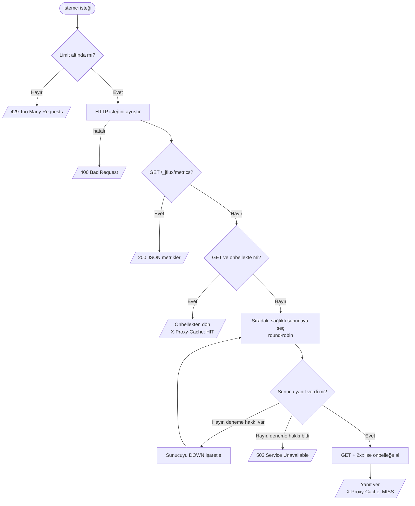

<div align="center">

# ⚡ JFlux

**Saf Java ile yazılmış, harici bağımlılığı olmayan, hafif bir HTTP ters vekil sunucu (reverse proxy) ve yük dengeleyici.**

Round-robin yük dengeleme · Otomatik yük devretme · Yanıt önbelleği · İstek sınırlama · Canlı metrikler


[🇬🇧 English](README.md) · **🇹🇷 Türkçe**

</div>

---

## İçindekiler

- [Genel Bakış](#genel-bakış)
- [Özellikler](#özellikler)
- [Mimari](#mimari)
- [Başlarken](#başlarken)
- [Yapılandırma](#yapılandırma)
- [Kullanım ve Demo](#kullanım-ve-demo)
- [Metrik Uç Noktası](#metrik-uç-noktası)
- [Nasıl Çalışır?](#nasıl-çalışır)
- [Proje Yapısı](#proje-yapısı)
- [Bilinen Sınırlamalar](#bilinen-sınırlamalar)
- [Yol Haritası](#yol-haritası)
- [Geliştirici](#geliştirici)

---

## Genel Bakış

JFlux, arka uç (backend) servislerinizin önünde durur ve gelen HTTP trafiğini bu servisler arasında dağıtır. Yalnızca Java standart kütüphanesi kullanılarak sıfırdan yazılmıştır: ağ katmanında ham `ServerSocket`, arka uca yapılan çağrılarda `java.net.http.HttpClient` ve her istemci bağlantısına thread havuzu maliyeti olmadan kendi hafif thread'ini veren **sanal thread'ler** (Project Loom) kullanılır.

Bir öğleden sonrada baştan sona okunabilecek kadar küçüktür (~800 satır); buna rağmen üretim seviyesindeki bir ters vekil sunucunun temel yapı taşlarını içerir: yük dengeleme, sağlık kontrolü, yük devretme (failover), önbellekleme, istek sınırlama ve gözlemlenebilirlik.

```
                         ┌──────────────────────────────────────────┐
                         │                  JFlux                   │
                         │                                          │
   İstemciler ────────►  │  Rate Limit → Cache → Load Balancer ─────┼──►  Backend :9001
   (curl, tarayıcı,      │      │          │          │   ▲        │──►  Backend :9002
    servisler…)          │      ▼          ▼          ▼   │        │──►  Backend :9003
                         │    429        HIT/MISS   Retry/Failover │
                         │                          Sağlık Kontrolü │
                         └──────────────────────────────────────────┘
```

## Özellikler

| | Özellik | Açıklama |
|---|---|---|
| ⚖️ | **Round-robin yük dengeleme** | İstekler, tüm *sağlıklı* arka uç sunucular arasında eşit şekilde dağıtılır. |
| 🩺 | **Aktif sağlık kontrolü** | Arka plandaki bir görev, ayarlanabilir aralıklarla her sunucuya TCP bağlantısı deneyerek sunucuları otomatik olarak `UP` / `DOWN` işaretler. |
| 🔁 | **Pasif yük devretme ve yeniden deneme** | Bir sunucu istek sırasında hata verirse anında `DOWN` olarak işaretlenir ve istek farklı bir sunucuda tekrar denenir — istemci hiçbir şey fark etmez. |
| 🗄️ | **Bellek içi yanıt önbelleği** | Başarılı `GET` yanıtları (`2xx`) ayarlanabilir bir TTL ile önbelleğe alınır. Önbellekten dönen yanıtlar `X-Proxy-Cache: HIT` başlığıyla işaretlenir. |
| 🚦 | **İstemci bazlı istek sınırlama** | İstemci IP'sine göre sabit pencereli (fixed-window) sınırlayıcı. Limiti aşan istekler `429 Too Many Requests` alır. |
| 📊 | **Yerleşik metrikler** | İstek sayıları, cache hit/miss, sınırlanan ve başarısız istekler ile sunucu bazlı trafiği gösteren bir JSON uç noktası. |
| 🧵 | **Sanal thread'ler** | Bağlantı başına bir sanal thread (`Executors.newVirtualThreadPerTaskExecutor()`): basit, bloklayıcı tarzda kod yazılırken yüksek ölçeklenebilirlik korunur. |
| ⚙️ | **Esnek yapılandırma** | Properties dosyası (harici veya paketlenmiş) ve güvenli varsayılan değerler. Geçersiz değerler proxy'yi çökertmez; varsayılana düşer. |
| 📦 | **Sıfır bağımlılık** | JDK dışında indirilecek hiçbir şey yok. |

## Mimari

### İstek yaşam döngüsü



### Bileşenler

| Bileşen | Sorumluluk |
|---|---|
| `ProxyServer` | TCP bağlantılarını kabul eder ve her birini bir sanal thread'e devreder. Diğer tüm bileşenlerin yaşam döngüsünü yönetir. |
| `ClientHandler` | İsteği ayrıştırır; istek sınırı → metrik rotası → önbellek → yeniden denemeli yönlendirme adımlarını uygular ve yanıtı yazar. |
| `LoadBalancer` | Sunucu listesini tutar, sağlıklı sunucular üzerinde round-robin seçim yapar ve zamanlanmış TCP sağlık kontrollerini çalıştırır. |
| `ResponseCache` | `ConcurrentHashMap` tabanlı, thread-safe TTL önbelleği; süresi dolan kayıtlar okunurken temizlenir. |
| `RateLimiter` | İstemci anahtarı (IP adresi) başına thread-safe sabit pencereli sayaç. |
| `MetricsCollector` | Kilitsiz sayaçlar (`AtomicLong`); istenildiğinde JSON olarak üretilir. |
| `ProxyConfig` | `config.properties` dosyasından, varsayılan ve doğrulama mantığıyla yüklenen değişmez (immutable) bir `record`. |
| `MockBackendRunner` | Yerel testler için `9001–9003` portlarında üç küçük demo sunucusu başlatır. |

## Başlarken

### Gereksinimler

- **JDK 25** (`pom.xml` dosyasında hedeflenen sürüm)
- **Apache Maven 3.9+** *(isteğe bağlı — düz `javac` ile de derleyebilirsiniz)*

> 💡 Kod yalnızca Java 21'den beri bulunan özellikleri kullanır (record'lar, switch ifadeleri, sanal thread'ler). Daha eski bir JDK'da çalıştırmak isterseniz `pom.xml` içindeki `maven.compiler.source` / `target` değerlerini düşürebilirsiniz.

### 1. Klonla ve derle

```bash
git clone https://github.com/mirayyozcann/JFlux.git
cd JFlux
mvn clean compile
```

<details>
<summary>Maven olmadan derleme</summary>

```bash
mkdir -p out
javac -d out $(find src/main/java -name "*.java")
# çalıştırmak için: java -cp out:src/main/resources com.jflux.Main
```

</details>

### 2. Demo sunucularını başlat

İlk terminalde:

```bash
java -cp target/classes com.jflux.testutil.MockBackendRunner
```

```
Mock backend started on http://localhost:9001
Mock backend started on http://localhost:9002
Mock backend started on http://localhost:9003
```

### 3. JFlux'u başlat

İkinci terminalde:

```bash
java -cp target/classes com.jflux.Main
```

```
JFlux Reverse Proxy listening on http://localhost:8080
Backends: [http://localhost:9001, http://localhost:9002, http://localhost:9003]
Metrics endpoint: http://localhost:8080/_jflux/metrics
```

`Ctrl+C` ile istediğiniz an durdurabilirsiniz — kapanış kancası (shutdown hook) sağlık kontrolcüsünü ve sunucuyu düzgün şekilde kapatır.

## Yapılandırma

JFlux, `config.properties` dosyasını okur. Arama sırası:

1. **Çalışma dizinindeki** `./config.properties` (harici override — yeniden derleme gerekmez)
2. **Classpath** içindeki `config.properties` (`src/main/resources`)
3. **Yerleşik varsayılanlar**

Eksik veya ayrıştırılamayan değerler sessizce varsayılana döner.

| Özellik | Varsayılan | Açıklama |
|---|---|---|
| `proxy.port` | `8080` | Proxy'nin dinlediği port. |
| `backend.urls` | `http://localhost:9001,http://localhost:9002,http://localhost:9003` | Virgülle ayrılmış arka uç temel URL'leri. |
| `cache.ttl.millis` | `10000` | Önbelleğe alınan bir `GET` yanıtının milisaniye cinsinden ömrü. Önbelleği kapatmak için `0` yapın. |
| `ratelimit.max.per.minute` | `30` | İstemci IP'si başına, 60 saniyelik pencerede izin verilen en fazla istek. Sınırlamayı kapatmak için `0` yapın. |
| `healthcheck.interval.millis` | `5000` | TCP sağlık kontrolleri arasındaki süre (bağlantı zaman aşımı: 1 sn). |
| `proxy.max.retries` | `3` | Bir istek için en fazla arka uç deneme sayısı (geçerli minimum değer: `1`). |

**Örnek** — canlı ortama yakın bir profil (JAR/class dosyalarının yanına konur):

```properties
proxy.port=80
backend.urls=http://10.0.0.11:8000,http://10.0.0.12:8000
cache.ttl.millis=30000
ratelimit.max.per.minute=300
healthcheck.interval.millis=3000
proxy.max.retries=2
```

## Kullanım ve Demo

### Yük dengeleme

Her istek, döngüdeki bir sonraki arka uca gider:

```bash
curl -i localhost:8080/hello1
curl -i localhost:8080/hello2
curl -i localhost:8080/hello3
curl -i localhost:8080/hello4
```

```
Hello from backend on port 9001 | path=/hello1
Hello from backend on port 9002 | path=/hello2
Hello from backend on port 9003 | path=/hello3
Hello from backend on port 9001 | path=/hello4
```

### Önbellekleme

TTL süresi içinde aynı `GET` isteğini tekrarlayın ve `X-Proxy-Cache` başlığına bakın:

```bash
curl -si localhost:8080/hello1 | grep X-Proxy-Cache   # X-Proxy-Cache: MISS
curl -si localhost:8080/hello1 | grep X-Proxy-Cache   # X-Proxy-Cache: HIT
```

Proxy günlüğü:

```
[FORWARD] GET /hello1 -> http://localhost:9001 (200, attempts=1)
[CACHE HIT] GET /hello1
```

### Yük devretme (Failover)

1. Demo sunuculardan birini durdurun (ör. `9002` portundaki süreci sonlandırın veya runner'ı durdurup yalnızca iki port başlatın).
2. İstek göndermeye devam edin — hiçbiri hata vermez. JFlux ölü sunucuyu tespit eder, günlüğe yazar ve trafiği onun çevresinden yönlendirir:

```
[FAILOVER] Attempt 1 failed on http://localhost:9002 (...), marking DOWN and retrying...
```

3. Sunucu geri geldiğinde, bir sonraki sağlık kontrolü onu tekrar `UP` olarak işaretler:

```
[HEALTH] http://localhost:9002 -> UP
```

**Tüm** sunucular kapalıysa istemciler `503 Service Unavailable` alır.

### İstek sınırlama

IP başına dakikada 30 istek olan varsayılan limitle:

```bash
for i in $(seq 1 35); do curl -s -o /dev/null -w "%{http_code} " localhost:8080/page$i; done
# 200 200 200 ... 200 429 429 429 429 429
```

Sınırlanan istekler metrik uç noktasında sayılır ve hiçbir zaman bir arka uca ulaşmaz.

## Metrik Uç Noktası

```bash
curl localhost:8080/_jflux/metrics
```

```json
{
  "totalRequests": 42,
  "cacheHits": 9,
  "cacheMisses": 28,
  "rateLimited429": 5,
  "failed503": 0,
  "backendSuccess": {"http://localhost:9001":10, "http://localhost:9002":9, "http://localhost:9003":9}
}
```

| Alan | Anlamı |
|---|---|
| `totalRequests` | Proxy'nin kabul ettiği her bağlantı (sınırlananlar dahil). |
| `cacheHits` | Doğrudan önbellekten yanıtlanan istekler. |
| `cacheMisses` | Bir arka uca gitmek zorunda kalan istekler (hiçbir zaman önbelleğe alınmayan `GET` dışı metotlar da dahil). |
| `rateLimited429` | İstek sınırlayıcı tarafından reddedilen istekler. |
| `failed503` | Tüm arka uç denemelerinin başarısız olduğu istekler. |
| `backendSuccess` | Sunucu başına verilen başarılı yanıt sayısı — dengenin doğru çalıştığını hızlıca doğrulamak için. |

## Nasıl Çalışır?

**Yük dengeleme.** `LoadBalancer.nextServer()` sunucu listesini sağlıklı olanlara indirger ve atomik bir sayaç ile `Math.floorMod` kullanarak birini seçer; böylece kilit kullanmadan thread-safe round-robin elde edilir.

**Sağlık kontrolleri.** Tek thread'li bir `ScheduledExecutorService`, her `healthcheck.interval.millis` süresinde tüm sunuculara TCP bağlantısı açmayı dener. Durum değişiklikleri (`UP` ⇄ `DOWN`) günlüğe yazılır.

**Yük devretme.** İstek yönlendirilirken `IOException` (bağlantı reddedildi, zaman aşımı vb.) oluşursa sunucu, bir sonraki sağlık kontrolünü beklemeden hemen `DOWN` işaretlenir ve istek en fazla `proxy.max.retries` deneme olacak şekilde *farklı* bir sunucuda tekrar denenir. Arka uç zaman aşımları: bağlantı için 2 sn, istek başına 3 sn.

**Önbellekleme.** Yalnızca `2xx` yanıt dönen `GET` istekleri önbelleğe alınır. Anahtar `METOT:path` biçimindedir (sorgu dizesi dahil). Süresi dolan kayıtlar bir sonraki istekte temizlenir (lazy eviction). Arka uçtan gelen `Transfer-Encoding` ve `Content-Length` başlıkları yanıttan çıkarılır ve `Content-Length` istemci için yeniden hesaplanır.

**İstek sınırlama.** Her istemci IP'si için bir sayaç ve pencere başlangıç zamanı tutulur. 60 saniye geçtiğinde pencere sıfırlanır; sayaç limite ulaşırsa o penceredeki sonraki istekler `429` ile yanıtlanır.

**HTTP işleme.** JFlux istek satırını ve başlıkları kendisi ayrıştırır, istek gövdesini okumak için `Content-Length` değerini dikkate alır, seçilen arka uca metodu, yolu ve gövdeyi iletir ve yanıtı `Connection: close` ile döner.

## Proje Yapısı

```
JFlux/
├── pom.xml
└── src/main/
    ├── resources/
    │   └── config.properties           # varsayılan yapılandırma
    └── java/com/jflux/
        ├── Main.java                   # giriş noktası + shutdown hook
        ├── balancer/
        │   └── LoadBalancer.java       # round-robin + sağlık kontrolleri
        ├── cache/
        │   └── ResponseCache.java      # TTL'li yanıt önbelleği
        ├── config/
        │   └── ProxyConfig.java        # yapılandırma record'u ve yükleyici
        ├── metrics/
        │   └── MetricsCollector.java   # sayaçlar + JSON rapor
        ├── model/
        │   ├── BackendServer.java      # sunucu URL'si + sağlık bayrağı
        │   └── HttpResponseData.java   # durum kodu, başlıklar, gövde
        ├── ratelimit/
        │   └── RateLimiter.java        # IP bazlı sabit pencereli sınırlayıcı
        ├── server/
        │   ├── ProxyServer.java        # kabul döngüsü (sanal thread'ler)
        │   └── ClientHandler.java      # istek işleme hattı
        └── testutil/
            └── MockBackendRunner.java  # 9001–9003 portlarında demo sunucular
```

## Bilinen Sınırlamalar

JFlux öğrenme amaçlı bir projedir ve bilinçli olarak sade tutulmuştur. Gerçek trafiğin önüne koymadan önce bilinmesi gerekenler:

- **İstek başlıkları arka uca iletilmez** — yalnızca metot, yol ve gövde iletilir. `Host`, `Authorization` veya `Content-Type` gibi başlıklar arka uca ulaşmaz.
- **Yalnızca HTTP/1.1, keep-alive yok** — her bağlantı tek yanıttan sonra kapatılır. HTTPS/TLS sonlandırma, WebSocket veya chunked istek desteği yoktur.
- **Yük devretme bağlantı seviyesindedir.** Arka uçtan dönen `5xx` yanıtlar olduğu gibi istemciye iletilir ve yeniden denemeyi tetiklemez.
- **Önbelleğin boyut sınırı yoktur** ve `Cache-Control` başlıklarını dikkate almaz; süresi dolan kayıtlar yalnızca tekrar istendiklerinde temizlenir.
- **Rate limiter durumu hiç temizlenmez;** çok sayıda farklı istemci IP'si olursa bellek zamanla büyür. Ayrıca sınırlayıcı doğrudan bağlanan adresi kullanır (`X-Forwarded-For` dikkate alınmaz).
- **Sağlık kontrolleri TCP seviyesindedir** — bağlantı kabul edip hata dönen bir sunucu yine de `UP` sayılır.
- **Reason phrase'ler** yalnızca birkaç durum kodu için tanımlıdır (200, 201, 400, 404, 429, 502, 503); diğer durum kodlarında `OK` ifadesi gönderilir (sayısal kod her zaman doğrudur).

## Yol Haritası

- [ ] İstek başlıklarını iletme ve temizleme (`Host`, `X-Forwarded-For`, …)
- [ ] HTTP seviyesinde sağlık kontrolleri (ör. `GET /health`)
- [ ] Ağırlıklı round-robin ve least-connections stratejileri
- [ ] `Cache-Control` destekli, sınırlı boyutlu LRU önbellek ve periyodik temizlik
- [ ] Keep-alive bağlantılar ve akış (streaming) gövdeler
- [ ] Birim ve entegrasyon testleri (JUnit 5)
- [ ] Prometheus uyumlu metrik formatı
- [ ] Docker imajı ve `docker-compose` demosu


<div align="center">

JFlux'u faydalı veya ilginç bulduysanız bir ⭐ vermeyi unutmayın

</div>
