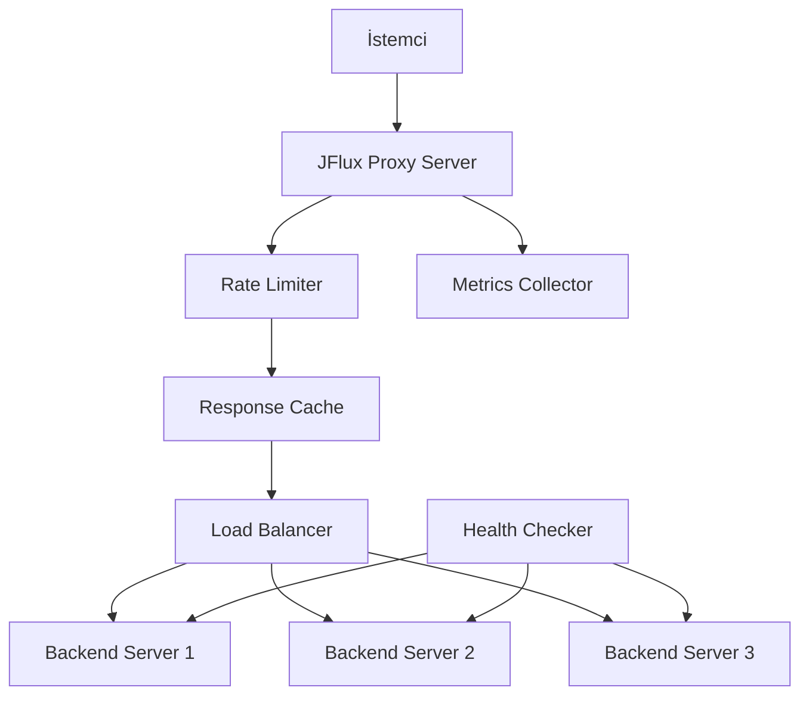

<h1 align="center">⚡ JFlux</h1>

<h3 align="center">Hafif ve Modüler Java Tabanlı Reverse Proxy & Backend Trafik Yönetim Sistemi</h3>
<p align="center">
  <strong>Akıllı Trafik Dağıtımı. Güvenilir Backend İletişimi.</strong>
</p>
<p align="center">
  <a href="README.md">🇬🇧 English</a> · <a href="README_TR.md">🇹🇷 Türkçe</a>
</p>
<p align="center">
  
  
  
  
  
</p>

---

## 🚀 Genel Bakış

**JFlux**, Java kullanılarak sıfırdan geliştirilmiş hafif bir **Reverse Proxy (Ters Proxy)** sunucu uygulamasıdır. Gelen HTTP isteklerini karşılayarak birden fazla arka plan (backend) sunucusuna dağıtır.

Proje; yük dengeleme (load balancing), yanıt önbellekleme (response caching), hız sınırlama (rate limiting), sunucu sağlık kontrolü (health check), otomatik yedek sunucuya geçiş (failover) ve canlı performans metrikleri gibi temel backend altyapı kavramlarını modüler bir mimaride birleştirir.

JFlux, modern backend sistemlerinin gelen trafiği nasıl yönettiğini, sunucu kesintilerini nasıl tolere ettiğini ve istemciler ile servisler arasında güvenilir iletişimi nasıl sürdürdüğünü uygulamalı olarak gösterir.

## ✨ Öne Çıkan Özellikler

| Özellik | Açıklama |
| :--- | :--- |
| 🔀 **Reverse Proxy** | İstemcilerden gelen HTTP isteklerini karşılar ve backend sunucularına iletir. |
| ⚖️ **Load Balancer** | Gelen istekleri Round-Robin algoritmasıyla aktif sunucular arasında dağıtır. |
| ⚡ **Response Cache** | Başarılı `GET` yanıtlarını yapılandırılabilir TTL süresi boyunca bellekte tutar. |
| 🛡️ **Rate Limiter** | İstemci IP adresine göre dakikalık istek sıklığını sınırlandırır (`429`). |
| 💓 **Health Checks** | Arka plan sunucularının erişilebilirliğini düzenli aralıklarla kontrol eder. |
| 🔄 **Automatic Failover** | Bir sunucu erişilemez olduğunda isteği sağlıklı diğer sunucuya yönlendirir. |
| 🔁 **Retry Mechanism** | Başarısız istekler için yapılandırılabilir yeniden deneme mekanizması sunar. |
| 📊 **Metrics Collector** | İstek istatistiklerini ve sunucu bazlı başarı oranlarını `/_jflux/metrics` üzerinden sunar. |
| 🧵 **Virtual Threads** | Eşzamanlı istemci bağlantılarını Java Virtual Threads ile hafif şekilde yönetir. |

## 🏗️ Sistem Mimarisi

JFlux, her bileşenin istek işleme sürecinin belirli bir aşamasından sorumlu olduğu modüler bir mimari izler.



### Temel Bileşenler

* **ProxyServer:** Ana soket sunucusunu ve gelen bağlantıları yönetir.
* **ClientHandler:** İstemci isteklerini ayrıştırır, önbellek ve backend iletişimini yürütür.
* **LoadBalancer:** Sağlıklı backend sunucusunu seçer ve sağlık kontrollerini koordine eder.
* **ResponseCache:** TTL tabanlı geçici yanıt önbelleğini yönetir.
* **RateLimiter:** İstemci bazlı istek sıklığını kontrol eder.
* **MetricsCollector:** Uygulama performans sayaçlarını toplar.
* **ProxyConfig:** `config.properties` üzerinden çalışma zamanı ayarlarını yükler.

## 🛠️ Teknoloji Yığını

<p align="center">
  
  
  
</p>

| Teknoloji | Kullanım Amacı |
| :--- | :--- |
| **Java 25** | Ana uygulama geliştirme dili |
| **Maven** | Proje ve derleme yönetimi |
| **Java Sockets** | İstemci bağlantılarının dinlenmesi ve yönetimi |
| **Java HttpClient** | Backend sunucularıyla HTTP iletişimi |
| **Virtual Threads** | Yüksek eşzamanlılıklı I/O işleme |
| **ConcurrentHashMap** | Thread-safe bellek ve önbellek yönetimi |
| **AtomicInteger / AtomicLong** | Kilit gerektirmeyen atomik sayaç işlemleri |
| **ScheduledExecutorService** | Periyodik sağlık kontrolü görevleri |

## 📂 Proje Yapısı

```text
JFlux/
│
├── src/
│   └── main/
│       ├── java/
│       │   └── com/jflux/
│       │       ├── balancer/
│       │       │   └── LoadBalancer.java
│       │       ├── cache/
│       │       │   └── ResponseCache.java
│       │       ├── config/
│       │       │   └── ProxyConfig.java
│       │       ├── metrics/
│       │       │   └── MetricsCollector.java
│       │       ├── model/
│       │       │   ├── BackendServer.java
│       │       │   └── HttpResponseData.java
│       │       ├── ratelimit/
│       │       │   └── RateLimiter.java
│       │       ├── server/
│       │       │   ├── ClientHandler.java
│       │       │   └── ProxyServer.java
│       │       ├── testutil/
│       │       │   └── MockBackendRunner.java
│       │       └── Main.java
│       │
│       └── resources/
│           └── config.properties
│
├── pom.xml
├── README.md
└── README_TR.md
```

## ⚙️ Kurulum ve Çalıştırma

### Gereksinimler

* Java JDK 25
* Apache Maven
* IntelliJ IDEA (önerilir)

### 1. Repoyu Klonlayın

```bash
git clone [https://github.com/mirayyozcann/JFlux.git](https://github.com/mirayyozcann/JFlux.git)
cd JFlux
```

### 2. Projeyi Derleyin

```bash
mvn clean compile
```

### 3. Örnek Backend Sunucularını Başlatın

IntelliJ IDEA üzerinden şu sınıfı çalıştırın (`9001`, `9002`, `9003` portlarını açar):

```text
com.jflux.testutil.MockBackendRunner
```

### 4. JFlux'ı Başlatın

Ana sınıfı çalıştırın:

```text
com.jflux.Main
```

### 5. İstek Gönderin

```bash
curl http://localhost:8080/
```

## 📊 Canlı Metrik Uç Noktası

```text
http://localhost:8080/_jflux/metrics
```

## 🎯 Projenin Amaçları

* Reverse proxy mimarisini derinlemesine anlamak ve uygulamak.
* Yük dengeleme stratejilerini pratik etmek.
* Java Virtual Threads ile eşzamanlı programlama deneyimi kazanmak.
* Backend erişilebilirliğini ve hata toleransı senaryolarını yönetmek.
* Önbellekleme ve hız sınırlama mekanizmalarını uygulamak.
* Uygulama metriklerini toplamak ve izlemek.

## 🔮 Gelecek Geliştirmeler

* Otomatik birim ve entegrasyon testlerinin genişletilmesi.
* Gelişmiş HTTP başlık (header) yönlendirme kuralları.
* Önbellek tahliye (eviction) politikalarının geliştirilmesi.
* İzlenebilirlik (observability) ve loglama iyileştirmeleri.
* Farklı yük dengeleme algoritmaları (örneğin *Least Connections*).

## 📌 Proje Durumu

JFlux, reverse proxy ve trafik yönetimi kavramlarını göstermek amacıyla geliştirilmiş bir backend altyapı projesidir ve yeni geliştirmelere açıktır.

---

<p align="center">
  <strong>⚡ JFlux — Hafif Proxy. Akıllı Trafik Yönetimi.</strong>
</p>
