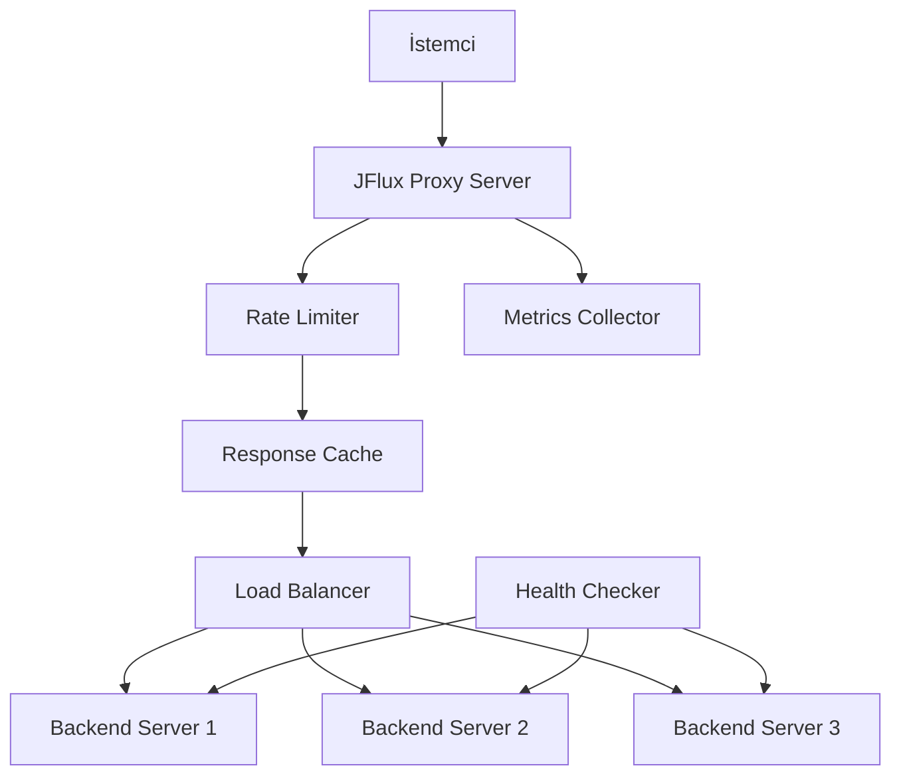

<h1 align="center">⚡ JFlux</h1>

<h3 align="center">Hafif ve Modüler Java Tabanlı Reverse Proxy & Backend Trafik Yönetim Sistemi</h3>
<p align="center">
  <strong>Akıllı Trafik Dağıtımı. Güvenilir Backend İletişimi.</strong>
</p>
<p align="center">
  <a href="README.md">🇬🇧 English</a> · <a href="README_TR.md">🇹🇷 Türkçe</a>
</p>
<p align="center">
  
  
  
  
  
</p>

---

## 🚀 Genel Bakış

**JFlux**, Java ile geliştirilmiş hafif bir **Reverse Proxy (Ters Proxy)** sunucu uygulamasıdır. Gelen HTTP isteklerini karşılayarak birden fazla backend sunucusuna dağıtır.

Proje; yük dengeleme (load balancing), yanıt önbellekleme (response caching), hız sınırlama (rate limiting), TCP tabanlı sunucu sağlık kontrolleri, bağlantı hatalarında failover ve performans metrikleri gibi temel backend altyapı kavramlarını modüler bir mimaride birleştirir.

JFlux, backend sistemlerinde gelen trafiğin nasıl yönlendirildiğini, sunucu bağlantı hatalarının nasıl ele alındığını ve istemciler ile servisler arasındaki iletişimin nasıl yönetildiğini uygulamalı olarak gösterir.

## ✨ Öne Çıkan Özellikler

| Özellik | Açıklama |
| :--- | :--- |
| 🔀 **Reverse Proxy** | İstemcilerden gelen HTTP isteklerini karşılar ve backend sunucularına iletir. |
| ⚖️ **Load Balancer** | Gelen istekleri Round-Robin algoritmasıyla sağlıklı backend sunucuları arasında dağıtır. |
| ⚡ **Response Cache** | Başarılı `GET` yanıtlarını yapılandırılabilir TTL süresi boyunca bellekte saklar. |
| 🛡️ **Rate Limiter** | İstemci IP adresine göre dakikalık istek sayısını sınırlandırır. Limit aşıldığında HTTP `429 Too Many Requests` yanıtı döndürür. |
| 💓 **Health Checks** | Backend sunucularının TCP bağlantı erişilebilirliğini düzenli aralıklarla kontrol eder. |
| 🔄 **Failover** | Backend bağlantısı başarısız olduğunda sunucuyu erişilemez olarak işaretler ve başka bir sağlıklı sunucuyu dener. |
| 🔁 **Retry Mechanism** | Başarısız backend bağlantı denemeleri için yapılandırılabilir yeniden deneme sayısı sunar. |
| 📊 **Metrics Collector** | İstek, cache, rate limit, hata ve backend başarı sayaçlarını `/_jflux/metrics` endpoint'i üzerinden JSON olarak sunar. |
| 🧵 **Virtual Threads** | İstemci bağlantılarını Java Virtual Threads kullanarak eşzamanlı şekilde yönetir. |

## 🏗️ Sistem Mimarisi

JFlux, her bileşenin istek işleme sürecinin belirli bir aşamasından sorumlu olduğu modüler bir mimari izler.



### Temel Bileşenler

- **ProxyServer:** Ana socket sunucusunu başlatır, gelen bağlantıları kabul eder ve istemci işlemlerini yönetir.
- **ClientHandler:** İstemci isteklerini ayrıştırır; rate limiting, cache kontrolü ve backend iletişimini yürütür.
- **LoadBalancer:** Sağlıklı backend sunucularını Round-Robin algoritmasıyla seçer ve TCP tabanlı sağlık kontrollerini yürütür.
- **ResponseCache:** Başarılı GET yanıtlarını TTL tabanlı olarak bellekte saklar.
- **RateLimiter:** İstemci IP adresine göre dakikalık istek sıklığını kontrol eder.
- **MetricsCollector:** İstek, cache, rate limit, hata ve backend başarı sayaçlarını toplar.
- **ProxyConfig:** Çalışma zamanı ayarlarını `config.properties` dosyasından yükler.

## 🛠️ Teknoloji Yığını

<p align="center">
  
  
  
</p>

| Teknoloji | Kullanım Amacı |
| :--- | :--- |
| **Java 25** | Ana uygulama geliştirme dili |
| **Maven** | Proje ve derleme yönetimi |
| **Java Sockets** | İstemci bağlantılarının dinlenmesi ve yönetimi |
| **Java HttpClient** | Backend sunucularıyla HTTP iletişimi |
| **Virtual Threads** | Eşzamanlı bağlantıların yönetimi |
| **ConcurrentHashMap** | Thread-safe bellek ve önbellek yönetimi |
| **AtomicInteger / AtomicLong** | Atomik sayaç ve indeks işlemleri |
| **ScheduledExecutorService** | Periyodik backend sağlık kontrolü görevleri |

## 📂 Proje Yapısı

```text
JFlux/
│
├── src/
│   └── main/
│       ├── java/
│       │   └── com/jflux/
│       │       ├── balancer/
│       │       │   └── LoadBalancer.java
│       │       ├── cache/
│       │       │   └── ResponseCache.java
│       │       ├── config/
│       │       │   └── ProxyConfig.java
│       │       ├── metrics/
│       │       │   └── MetricsCollector.java
│       │       ├── model/
│       │       │   ├── BackendServer.java
│       │       │   └── HttpResponseData.java
│       │       ├── ratelimit/
│       │       │   └── RateLimiter.java
│       │       ├── server/
│       │       │   ├── ClientHandler.java
│       │       │   └── ProxyServer.java
│       │       ├── testutil/
│       │       │   └── MockBackendRunner.java
│       │       └── Main.java
│       │
│       └── resources/
│           └── config.properties
│
├── pom.xml
├── README.md
└── README_TR.md
```

## ⚙️ Kurulum ve Çalıştırma

### Gereksinimler

- Java JDK 25
- Apache Maven
- IntelliJ IDEA (önerilir)

### 1. Repoyu Klonlayın

```bash
git clone [https://github.com/mirayyozcann/JFlux.git](https://github.com/mirayyozcann/JFlux.git)
cd JFlux
```

### 2. Projeyi Derleyin

```bash
mvn clean compile
```

### 3. Örnek Backend Sunucularını Başlatın

IntelliJ IDEA üzerinden aşağıdaki sınıfı çalıştırın. Bu sınıf `9001`, `9002` ve `9003` portlarında örnek backend sunucuları başlatır:

```text
com.jflux.testutil.MockBackendRunner
```

### 4. JFlux'ı Başlatın

Ana sınıfı çalıştırın:

```text
com.jflux.Main
```

JFlux varsayılan olarak `8080` portunda dinlemeye başlar.

### 5. İstek Gönderin

```bash
curl http://localhost:8080/
```

## ⚙️ Yapılandırma

JFlux, `config.properties` dosyası üzerinden yapılandırılabilir.

| Ayar | Varsayılan Değer | Açıklama |
| :--- | :--- | :--- |
| `proxy.port` | `8080` | Proxy sunucusunun portu |
| `backend.urls` | `localhost:9001,9002,9003` | Backend sunucularının adresleri |
| `cache.ttl.millis` | `10000` | Cache geçerlilik süresi (ms) |
| `ratelimit.max.per.minute` | `30` | IP başına dakikalık istek limiti |
| `healthcheck.interval.millis` | `5000` | TCP sağlık kontrolü aralığı (ms) |
| `proxy.max.retries` | `3` | Maksimum backend deneme sayısı |

## 📊 Metrik Endpoint'i

JFlux, toplanan metrikleri aşağıdaki endpoint üzerinden JSON formatında sunar:

```text
http://localhost:8080/_jflux/metrics
```

Rapor; toplam istek sayısı, cache hit/miss sayıları, rate limit nedeniyle reddedilen istekler, başarısız istekler ve backend başına başarılı istek sayaçlarını içerir.

## 🎯 Projenin Amaçları

- Reverse proxy mimarisini anlamak ve uygulamak.
- Round-Robin yük dengeleme stratejisini deneyimlemek.
- Java Virtual Threads ile eşzamanlı programlama pratiği yapmak.
- Backend erişilebilirliğini ve bağlantı hatalarını yönetmek.
- Önbellekleme ve hız sınırlama mekanizmalarını uygulamak.
- Uygulama metriklerini toplamak ve izlemek.

## 🔮 Gelecek Geliştirmeler

- Otomatik birim ve entegrasyon testlerinin genişletilmesi.
- Gelişmiş HTTP başlık (header) yönlendirme kurallarının eklenmesi.
- Önbellek tahliye (eviction) politikalarının geliştirilmesi.
- İzlenebilirlik (observability) ve loglama iyileştirmeleri.
- Farklı yük dengeleme algoritmalarının eklenmesi (örneğin *Least Connections*).

## 📌 Proje Durumu

JFlux, reverse proxy ve backend trafik yönetimi kavramlarını uygulamalı olarak göstermek amacıyla geliştirilmiş bir Java altyapı projesidir. Yeni özellikler ve iyileştirmelerle geliştirilmeye açıktır.

---

<p align="center">
  <strong>⚡ JFlux — Hafif Proxy. Akıllı Trafik Yönetimi.</strong>
</p>
